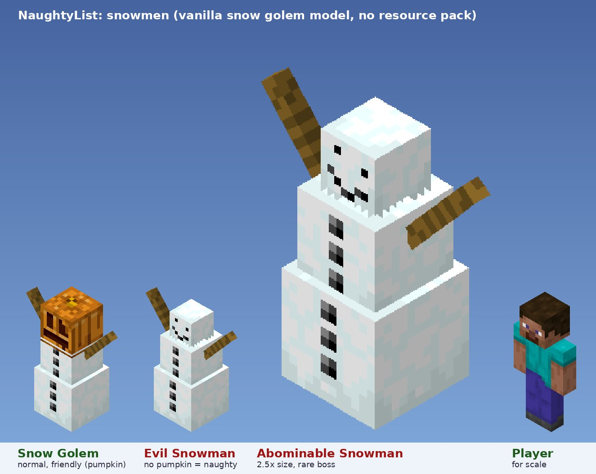

# NaughtyList 1.0.3: Christmas danger for XmasWorld servers

NaughtyList is a gameplay plugin for Paper that goes with **XmasWorld 1.3.x** (1.3.2 is current). It makes Christmas nights more
dangerous on a Hard server, while keeping it right for kids: there's no gore, and **nothing a player owns is
ever lost for good**.

| Feature | What players see |
|---|---|
| Evil snowmen | Red-named snow golems at night that throw ice shards. A hit does a little damage, slows you and frosts your screen. They melt at sunrise. |
| The Abominable Snowman | A rare giant (2.5x size, 80 health) that appears only in blizzards. It has a boss bar, ice volleys and a ground slam, and drops snow, ice, XP and the "Abominable's Carrot Nose" trophy. |
| Blizzards | About 1 night in 5, plus thunderstorms, with a 30-second warning. Outdoors your screen frosts over (no freeze damage), more monsters spawn, and shallow still water slowly freezes. Leather armor (25% per piece) or a roof keeps the frost away. |
| Grinch goblins | Small zombies in Santa suits. One grabs a stack from your backpack, never armor or your held item, and runs. Kill it and the item goes right back into your inventory. If it escapes, the item drops as glowing "Stolen Loot" that never despawns. Goblins can't steal inside your own GriefPrevention claim. |
| Coal presents | 10–15% of XmasWorld presents are traps. They fizz, then do one of four things: a small pop that breaks no blocks, coal in place of the loot (one real item kept), 3 "Coal Bug" silverfish, or 2 sword-less vex "sprites" that vanish after 15 s. Each present triggers only once. |
| Nutcracker soldiers | Skeleton archers in red coats guard the ice castle, pirate ship, toy mine, present maze, snowball fort and hidden sleigh. The ice castle also has a gold-helmet Captain. They don't burn in daylight, and the posts refill 60 minutes after they're cleared. |
| Safe zones | The North Pole, villages, cabins, cocoa stands, reindeer stables, hot springs and the area within 32 blocks of spawn. None of these threats work there and vanilla monsters don't spawn there. You can add WorldGuard regions too. |

Peaceful worlds and creative/spectator players are always left alone.

## Downloads

Jars are on the [GitHub Releases](https://github.com/tyjohnson16/NaughtyList/releases) page:

* `NaughtyList-1.0.3-mc26.1.2.jar` for Paper 26.1.2
* `NaughtyList-1.0.3-mc26.3.jar` for Paper 26.3

Full documentation is in [docs/NaughtyList-Documentation.md](docs/NaughtyList-Documentation.md). This plugin is meant to be used with [XmasWorld](https://github.com/tyjohnson16/XmasWorld) 1.3.x.



## Install

1. Install [XmasWorld 1.3.2](https://github.com/tyjohnson16/XmasWorld/releases) first (the `-mc26.1.2` or `-mc26.3` jar that matches your server).
   1.3.x changes nothing about world generation, so you can keep your world.
2. Download `NaughtyList-1.0.3-mc26.1.2.jar` (Paper 26.1.2) or `NaughtyList-1.0.3-mc26.3.jar` (Paper 26.3)
   from [Releases](https://github.com/tyjohnson16/NaughtyList/releases) and copy it into `plugins/`.
3. Make sure `difficulty=hard` is set (NaughtyList also works on Easy/Normal; damage values are exact on every difficulty).
4. Restart the server; `/reload` is not supported. The log should say
   `NaughtyList ready. XmasWorld API=true, WorldGuard=true, GriefPrevention=true`.
5. Optional: edit `plugins/NaughtyList/config.yml`, then run `/naughty reload`.

WorldGuard and GriefPrevention are optional. If either is missing, its features are simply off.

## Commands (permission `naughtylist.admin`, ops by default; alias `/nl`)

| Command | What it does |
|---|---|
| `/naughty status` | Shows the hooks, whether each world has a blizzard, how many threats and nutcracker posts are loaded, and the goblin escrow count |
| `/naughty reload` | Re-reads config.yml (any active blizzard ends safely) |
| `/naughty zone check` | Tells you whether you're standing in a safe zone or your own claim |
| `/naughty present [scan [radius]]` | Look at a present to see if it's a trap and why (doesn't set it off), or count presents and traps nearby |
| `/naughty blizzard start\|stop [world]` | Starts or stops a blizzard now. Starting one doesn't change the time; it lasts until the next sunrise (at least a minute). `/weather clear` or Essentials `/weather world sun` also ends one |
| `/naughty spawn snowman\|abominable\|goblin\|guard\|captain [world x y z]` | Spawns one for testing. Refused inside safe zones, with a message saying why. Spawned snowmen don't melt in daylight, so they work for daytime tests |

Permission `naughtylist.ignore` (default off) makes every threat ignore a player, e.g. a builder or a young child.

## Config (`plugins/NaughtyList/config.yml`)

Damage is in health points: 2 = 1 heart. The numbers are what the player takes before armor, on every difficulty.

* `worlds: [auto]` puts NaughtyList in every XmasWorld world, or list them by name, e.g. `[world]`. `max-mobs-per-world` caps NaughtyList mobs.
* **safe-zones**
  * `structures` lists the XmasWorld build types that are safe, with `padding` extra blocks around each.
  * `spawn-radius` sets the safe area around world spawn.
  * `worldguard-regions: [name, ...]` adds WorldGuard regions. Regions that deny mob spawning are respected anyway.
  * `griefprevention-claims: true` makes every claim fully safe. The default is false, because goblins already respect claims.
  * `block-vanilla-monster-spawns` stops vanilla monsters spawning in safe zones.
  * `clear-vanilla-targets` also stops vanilla monsters going after players in safe zones.
* **evil-snowmen**
  * `replace-chance` is how often a night surface monster spawn becomes a snowman (×`blizzard-multiplier` during blizzards).
  * `cap-per-player`, `health` and `shard` (damage, slowness, frost) tune the snowmen.
  * `abominable` sets the boss: `chance` per snowman spawn in a blizzard, `min-distance` between bosses, size, health, `volley` and `slam`.
* **blizzards**
  * `chance-per-night`, `during-thunderstorms`, `warning-seconds` and `max-minutes` (0 = until sunrise) control when they happen.
  * `frost-overlay`, `leather-reduces-frost` and `monster-cap-multiplier` set the effects.
  * `freeze-water` sets how fast still, 1-deep water freezes. It never freezes inside claims, regions or safe zones, next to farmland, or under entities.
* **grinch-goblins**
  * `replace-chance`, `cap-per-player` and `player-cooldown-minutes` (minimum time between thefts from one player) control how often they come.
  * `protect-own-claims` stops theft in your own claim.
  * `max-steal-amount` sets the biggest stack a goblin takes. `never-steal` lists materials (with `*` wildcards) it never takes, and `never-steal-named-items` protects renamed items.
  * `escape` sets when a goblin gives up: no player within `distance` for `seconds`, or `max-seconds` in total.
* **coal-presents**
  * `chance` is the share of presents that are traps, per present location.
  * `outcomes` are the weights of pop/coal/bugs/sprites, and each outcome has its own section.
  * `legacy-shape-detection` also finds presents generated before XmasWorld 1.3.0.
* **nutcrackers**
  * `posts` sets the guards per build type, and `captain-at` lists which posts get a Captain.
  * `guard` and `captain` set the colors, health and bow enchantments.
  * `leash` is how far guards chase.
  * `respawn-minutes` (60) is how long before a cleared post refills, but only while no player is within `respawn-player-distance`.
* **rewards**: console commands run on the kill. `%player%` is replaced, e.g. `abominable-kill: ["eco give %player% 100"]`.
  These are handy for AdvancedAchievements or Vault.
* `debug: true` adds extra log lines.

## How stolen items stay safe

* When the goblin dies for any reason (killed by a player, lava, the void, `/kill`), the item goes straight back into its owner's inventory. If the inventory is full, it drops at the owner's feet.
* If it escapes, a glowing "Stolen Loot" item drops that never despawns, and the owner gets a chat message with its rough location.
* If the owner is offline, the item is kept in `plugins/NaughtyList/stolen.yml` and handed back when they next join.
* Goblins keep stolen items in their own saved data, so restarts and chunk unloads don't lose anything.

## Notes and limitations

* Needs XmasWorld 1.3.0 for posts, safe zones and the present tags. With an older XmasWorld, only snowmen, goblins and blizzards work.
* Presents in chunks generated before 1.3.0 are found by their gift-box shape (`legacy-shape-detection`), even when a tree covers a corner. Creative and spectator players never set traps off; trapped presents open normally for them.
* A cleared nutcracker post refills only while its chunks are loaded and nobody is within 32 blocks, so guards never pop in in front of players.
* Essentials `/killall` skips named mobs, so it won't remove goblins or nutcrackers; use `/minecraft:kill`.
* Paper only (it uses Paper's mob-goal API). Spigot is not supported.

## Changes

See also [CHANGELOG.md](CHANGELOG.md).


* **1.0.3:** Coal presents: presents generated before XmasWorld 1.3.0 are recognised even when a Christmas tree's leaves, ornaments or lights replace a couple of the gift box's wool/concrete blocks (some presents under trees in older worlds were missed). Surface presents under trees are no longer mistaken for cave presents. In creative/spectator a trapped present now opens normally (with an action-bar note that it's armed) instead of silently refusing to open; it stays armed for survival players. New `/naughty present` (look at a present) explains whether it's a trap and why, and `/naughty present scan [radius]` counts presents and traps nearby.
* **1.0.2:** `/naughty spawn snowman` and `/naughty spawn abominable` no longer melt straight away in daytime. Command-spawned snowmen stay day and night (even if you're in creative) and melt only in a safe zone or when no player at all is within 96 blocks. Natural snowmen still melt at sunrise. The Abominable's giant size is re-applied after it spawns and every half second. A refused spawn now says why (world not enabled, safe zone, or WorldGuard mob-spawning deny).
* **1.0.1:** `/naughty blizzard start` no longer changes the world time (1.0.0 set it to night); a blizzard started in the daytime runs until the next sunrise. `/naughty status` shows the real plugin version.
* **1.0.0:** first release.

## Building from source

Requires **JDK 25** and the Gradle wrapper in this repository (`gradle-9.9.1`).

```
./gradlew build                                                              # 26.3 jar -> dist/
./gradlew build -PmcVersion=26.1.2 -PpaperApiVersion=26.1.2.build.74-stable   # 26.1.2 jar -> dist/
```

`libs/XmasWorld-api.jar` is included (compile-only). WorldGuard, FastAsyncWorldEdit and GriefPrevention jars are optional; if they are not in `libs/`, the build uses compile-only stubs under `stubs/` (they are not packaged into the plugin jar). See [libs/README.md](libs/README.md).

A small Mineflayer test client lives in `bot/`.

## License

[MIT](LICENSE), copyright 2026 tyjohnson16.
