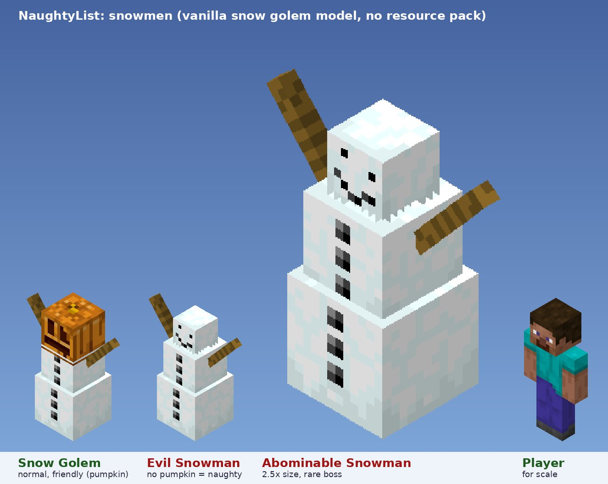
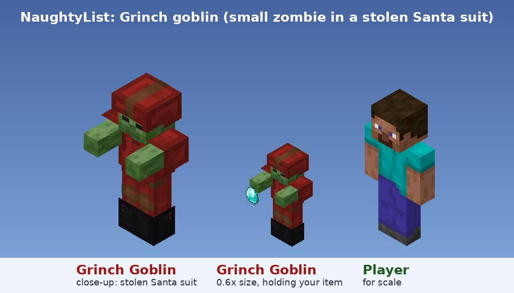
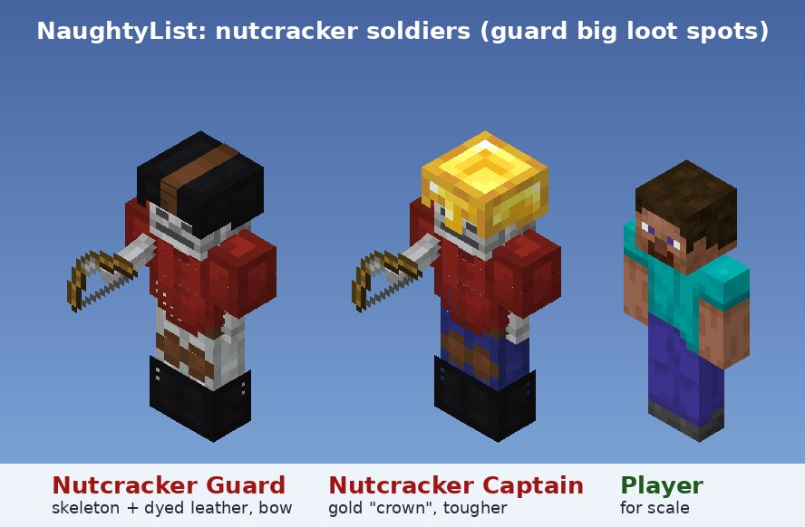

# NaughtyList 1.0.3 — Documentation

*Christmas-themed danger for hard-difficulty XmasWorld servers. By Stormrider.*

<!-- TOC -->
## Contents

1. [Overview](#overview)
2. [Requirements](#requirements)
3. [Installation](#installation)
4. [Updating](#updating)
5. [Feature guide](#feature-guide)
6. [Mobs and items reference](#mobs-and-items-reference)
7. [Player messages](#player-messages)
8. [Commands and permissions](#commands-and-permissions)
9. [Configuration reference (config.yml)](#configuration-reference-configyml)
10. [Data files](#data-files)
11. [Integrations](#integrations)
12. [Performance](#performance)
13. [Troubleshooting and FAQ](#troubleshooting-and-faq)
14. [How NaughtyList uses the XmasWorld 1.3 API](#how-naughtylist-uses-the-xmasworld-13-api)
15. [Building from source](#building-from-source)
16. [Changelog](#changelog)
<!-- /TOC -->

## Overview

XmasWorld makes the world friendly and full of loot. NaughtyList adds **more danger**, with a Christmas theme,
to balance that out on a Hard server, while staying right for kids: there's no gore, and **nothing a player
owns is ever lost for good**.

| Feature | In one line |
|---|---|
| Evil snowmen | Hostile snow golems that throw slowing ice shards at night and melt at sunrise |
| The Abominable Snowman | A rare giant boss that appears only in blizzards |
| Blizzards | Some nights turn into snowstorms: frosty screens outdoors, more monsters, freezing water |
| Grinch goblins | Sneaky goblins that steal one stack and run; you always get it back |
| Coal presents | Some XmasWorld presents are traps |
| Nutcracker soldiers | Archer guards at the bigger loot spots that refill over time |
| Safe zones | Villages, cabins, the North Pole, spawn and more stay safe from all of it |

Key facts:

| | |
|---|---|
| Plugin name | `NaughtyList` (main class `dev.stormrider.naughtylist.NaughtyListPlugin`) |
| Version | 1.0.3 |
| Command | `/naughty` (alias `/nl`) |
| Soft dependencies | XmasWorld, WorldGuard, GriefPrevention |
| Data folder | `plugins/NaughtyList/` (`config.yml`, `stolen.yml`) |

Who is never affected:

* Worlds on **Peaceful** difficulty.
* Players in **creative** or **spectator** mode, players with `naughtylist.ignore`, and players marked
  vanished by a vanish plugin.
* Anyone standing in a **safe zone**.



## Requirements

| Server | Jar | Java |
|---|---|---|
| Paper **26.1.2** | `NaughtyList-1.0.3-mc26.1.2.jar` | Java 25 |
| Paper **26.3** | `NaughtyList-1.0.3-mc26.3.jar` | Java 25 |

* **Paper is required** (it uses Paper's mob-goal API). Spigot is not supported.
* **XmasWorld 1.3.0 or newer** (1.3.1 is current) is strongly recommended. Without it, nutcracker posts and structure safe zones are off
  (see [Integrations](#integrations)).
* WorldGuard and GriefPrevention are optional.
* Designed for `difficulty=hard`, but it works on Easy and Normal too. Damage values in the config are what
  players take on every difficulty.

## Installation

1. Stop the server.
2. Install or update **XmasWorld 1.3.1** (replace the older XmasWorld jar). It doesn't change world
   generation, so keep your world.
3. Copy the NaughtyList jar for your server version into `plugins/`.
4. Start the server. The log should say:
   `NaughtyList ready. XmasWorld API=true, WorldGuard=true, GriefPrevention=true. Use /naughty status.`
   (`false` just means that plugin isn't installed.)
5. In game, run `/naughty status` and `/naughty zone check`.
6. Optional: edit `plugins/NaughtyList/config.yml`, then `/naughty reload`.

## Updating

Stop the server, replace the jar and start it again. Do a **full restart**; `/reload` and plugin managers
are not supported. Your `config.yml` is kept; new keys use their built-in defaults until you add them.

## Feature guide

### Evil snowmen

* At **night** (world time 13000–23000), some **natural surface spawns** of zombies, skeletons, spiders,
  creepers and strays near a player (within 48 blocks) are replaced by evil snowmen. The chance is
  `evil-snowmen.replace-chance` (12%), doubled during blizzards (`blizzard-multiplier`). Each player has at
  most `cap-per-player` (4) snowmen within 48 blocks.
* They are pumpkin-less snow golems named "Evil Snowman" with 16 health. They target the nearest player
  they can see within 16 blocks.
* Their snowballs become **ice shards**. A hit does `shard.damage` (2 = 1 heart) before armor, gives
  Slowness II for 2 s and frosts the screen a little. A raised **shield blocks the shard completely**.
  A player can only be hurt by one shard per second.
* They **melt** (with snowflake particles) at sunrise, inside a safe zone, or when no player is within
  96 blocks. They ignore rain, water and warm-biome melting damage.
* Snowmen and Abominables made with `/naughty spawn` don't melt at sunrise, so you can test them in the
  daytime. They still melt in a safe zone, or when no player at all (any game mode) is within 96 blocks.
* Drops: 2–4 snowballs.
* They don't spawn in water or in WorldGuard regions that deny mob spawning.

### The Abominable Snowman

* Only during a **blizzard**. When a snowman replacement happens, there is a
  `abominable.chance` (1.67%) chance it becomes the Abominable instead, as long as no other Abominable is
  within `min-distance` (256) blocks. It ignores the per-player snowman cap.
* A 2.5x-size snow golem with 80 health and a 24-block follow range.
* A **boss bar** ("The Abominable Snowman") shows to players within 40 blocks.
* **Ice volley:** every 3 s, if it can see you within 16 blocks, it throws 3 shards (3 damage each,
  Slowness III for 3 s).
* **Ground slam:** every 4 s, if you are within 3 blocks: 3 damage and a knockback push.
* Drops: 16 snow blocks, 8 packed ice, the **"Abominable's Carrot Nose"** trophy (a named golden carrot)
  and 50 XP. Runs the `rewards.abominable-kill` commands for the killer.
* In testing on Hard, an unarmored player took 3 per hit, and a player in full iron armor about 1.4 per hit
  every few seconds.

### Blizzards

* At the start of each night there is a `chance-per-night` (20%) roll. Thunderstorms always bring one when
  `during-thunderstorms` is on.
* **Warning:** a title "❄ Blizzard coming! ❄ / Find shelter, a roof or warm leather clothes" and a chat
  message, then after `warning-seconds` (30) the blizzard starts.
* While it lasts:
  * The world is set to storm until about sunrise. The monster spawn cap is multiplied by
    `monster-cap-multiplier` (1.5).
  * **Outdoor** players (nothing solid above their head, leaves don't count) get a frost overlay, snow and
    ash particles and wind sounds. The overlay is capped below the level where freezing damage starts, so
    it **never hurts**.
  * Each piece of **leather armor** reduces the frost by 25%, so a full leather set removes it.
  * Shallow (1-deep) still water near outdoor players slowly **turns to ice**, up to 6 blocks per player
    every 2 s within 24 blocks. Water is never frozen next to farmland (2 blocks), under or next to
    entities, inside GriefPrevention claims, inside any WorldGuard region, or in safe zones.
  * Evil snowmen are twice as common, and the Abominable can appear.
* **Ending:** at sunrise (the weather is cleared), when the storm stops (including `/weather clear` and
  Essentials `/weather <world> sun`), after `max-minutes` if set, or with `/naughty blizzard stop`.
  Players see "The blizzard is over. Phew!".
* **Started by command:** `/naughty blizzard start` keeps the current time. Started in the daytime, it runs
  through the day and night and ends at the next sunrise. Started at night, it ends at sunrise like a natural
  one. It always lasts at least one minute.

### Grinch goblins



* At night, a natural surface spawn near a player can become a **Grinch Goblin** instead
  (`replace-chance` 3%). The roll is checked before the snowman roll. At most `cap-per-player` (1) goblin
  per player within 48 blocks, and not while that player is on theft cooldown.
* A small (0.6x) fast zombie in an unbreakable red Santa suit with black boots, 12 health. It doesn't burn
  in daylight, doesn't pick up items and never calls reinforcements.
* **It never hurts players.** When it reaches you, instead of attacking, it **steals one stack**:
  * a random stack from your **backpack** first, or the **hotbar** if the backpack is empty;
  * **never** armor, the offhand, the item you're holding, items with a custom name
    (`never-steal-named-items`), or anything on `never-steal` (shulker boxes, bundles, ender chests,
    written books, totems and elytra by default);
  * at most `max-steal-amount` (16) items of the stack.
* After a theft, that player can't be robbed again for `player-cooldown-minutes` (10). The cooldown resets
  at restart.
* **Claim protection:** with `protect-own-claims: true`, a goblin can't steal while you stand in **your
  own** GriefPrevention claim. You see "The goblin can't steal on your own land!" and it runs off.
* After stealing, it **runs away** holding your item and won't target anyone else.
* **You always get it back:**

| What happens to the goblin | Where the item goes |
|---|---|
| Killed by any player | Straight back into the owner's inventory |
| Dies any other way (lava, the void, `/minecraft:kill`, another mob) | Straight back into the owner's inventory |
| Removed by a plugin | Back to the owner |
| **Escapes**: no player within 40 blocks for 30 s, 60 s of fleeing in total, daybreak, or it enters a safe zone | Dropped as a glowing, invulnerable, never-despawning **"Stolen Loot"** item. The owner gets a chat message with the rough location (rounded to 10 blocks) |
| Owner is **offline** when it dies or escapes | Saved in `stolen.yml` and handed back on the owner's next login |

  If the owner's inventory is full, the leftovers drop at the owner's feet. A goblin carrying loot is
  persistent and keeps the item in its own saved data, so restarts and chunk unloads don't lose anything.
  A goblin killed by a player runs the `rewards.goblin-kill` commands.

### Coal presents

* A share of **XmasWorld presents** are traps: `chance.surface` 10%, `cave` 15%, `buried` 15%,
  `under-ice` 0%. Whether a present is a trap, and which kind, is fixed by the world seed and its position,
  so it can't be re-rolled.
* Opening or breaking a trap present makes it **fizz** (TNT hiss, smoke, "This present is fizzing... step
  back!") for `fuse-seconds` (1.5). Then one outcome happens, picked by weight. When a coal-outcome barrel is
  broken, its loot is changed immediately before it drops (no fuse):

| Outcome | Weight | What happens |
|---|---|---|
| `pop` | 40 | Snowy explosion particles and sound. **No blocks break.** Damage falls off with distance: up to 6 at the centre, 0 at 3 blocks. Halved while blocking with a shield. Plus a knockback push |
| `coal` | 30 | The loot is replaced with 3–8 coal, keeping **one** random real item. "Lumps of coal! Somebody's been naughty..." |
| `bugs` | 20 | 3 silverfish named "Coal Bug" |
| `sprites` | 10 | 2 vexes named "Naughty Sprite" with **no sword** that vanish after 15 s |

* Each present triggers **only once** (marked `naughtylist:sprung`). After `pop`, `bugs` or `sprites`, open it
  again to take the normal loot.
* Creative and spectator players never trigger traps. A trapped present opens normally for them, with an
  action-bar note that it's armed, and stays armed for survival players. Presents in safe zones (spawn area,
  North Pole, villages, cabins and the other `safe-zones.structures`) are never traps.
* At the default chances about 1 in 10 surface presents is a trap, so opening 20 without finding one
  happens about 12% of the time. Use `/naughty present scan` to see how many are trapped nearby.
* Presents are recognized by the `xmasworld:loot` tag (XmasWorld 1.3.0+). For presents generated earlier,
  `legacy-shape-detection` recognizes the gift box: a barrel facing up, on wool or concrete, with at least 6
  of its 8 sides wool or concrete (a tree's leaves or ornaments often replace one or two). It counts as a
  cave present only when real ground (stone, dirt...) is above it, not tree leaves or snow.
* The trap is decided when the present is opened or broken (not when the chunk loads), so presents in chunks
  generated or loaded earlier work too.

### Nutcracker soldiers



* Guard posts are XmasWorld builds listed under `nutcrackers.posts`, with the number of guards for each:
  ice castle 4, pirate ship 3, toy mine 3, present maze 3, snowball fort 3, hidden sleigh 2.
  The **ice castle** also gets a **Nutcracker Captain** (`captain-at`).
* **Nutcracker Guard:** a skeleton archer with 30 health in an unbreakable red coat, white trousers and
  black cap and boots. It doesn't burn in daylight and never despawns. Its gear never drops.
* **Nutcracker Captain:** 45 health, a gold helmet and a Power II / Punch I bow. Drops a **"Captain's Medal"**
  (a named gold nugget) and 25 XP, and runs the `rewards.captain-kill` commands.
* **Garrison:** when a post's chunk loads, NaughtyList fills it with guards, but only while no player is
  within 32 blocks, so guards never pop up in front of anyone. Surface guards stand on top of the build;
  underground guards spawn inside the chamber.
* **Patrol:** guards wander around their post. If a chase pulls one more than `leash` (24) blocks from home,
  or its target enters a safe zone, it gives up and walks home.
* **Refill:** once `respawn-minutes` (60) have passed since the post was last filled, missing guards are
  replaced the next time the post is loaded with no player within 32 blocks. The fill time is saved in the
  chunk, so it survives restarts.
* Posts inside safe zones get no guards.

### Safe zones

A location is safe if any of these is true:

| Safe zone | Config |
|---|---|
| XmasWorld builds: North Pole, Christmas village, cabins, cocoa stands, reindeer stables and hot springs, plus 6 blocks of padding around each footprint | `safe-zones.structures`, `safe-zones.padding` |
| A 32-block square around world spawn | `safe-zones.spawn-radius` |
| WorldGuard regions you list by name | `safe-zones.worldguard-regions` |
| Every GriefPrevention claim (off by default) | `safe-zones.griefprevention-claims` |

In a safe zone:

* NaughtyList mobs don't spawn and won't target you. Snowmen melt, and goblins give up and drop their loot.
* Vanilla monsters don't spawn naturally (`block-vanilla-monster-spawns`). Optionally, vanilla monsters also
  stop targeting players there (`clear-vanilla-targets`).
* Blizzard frost doesn't apply, water doesn't freeze, and presents are never traps.

Separately, **WorldGuard regions that deny `mob-spawning`** block every NaughtyList spawn (snowmen,
goblins, guards, coal bugs and sprites).

## Mobs and items reference

| Mob | Base | Health | Name | Drops |
|---|---|---|---|---|
| Evil Snowman | Snow golem | 16 | Evil Snowman (red) | 2–4 snowballs |
| Abominable Snowman | Snow golem, 2.5x | 80 | The Abominable Snowman (gold) | 16 snow blocks, 8 packed ice, Abominable's Carrot Nose, 50 XP |
| Grinch Goblin | Zombie, 0.6x | 12 | Grinch Goblin (red) | Nothing (the stolen item goes back to its owner) |
| Nutcracker Guard | Skeleton | 30 | Nutcracker Guard (red) | Normal skeleton drops, no gear |
| Nutcracker Captain | Skeleton | 45 | Nutcracker Captain (gold) | Captain's Medal, 25 XP, normal skeleton drops |
| Coal Bug | Silverfish | vanilla | Coal Bug | vanilla |
| Naughty Sprite | Vex, no sword | vanilla | Naughty Sprite | vanilla; vanishes after 15 s |

Every NaughtyList mob carries the tag `naughtylist:type` (`snowman`, `abominable`, `goblin`, `guard`,
`captain`, `bug` or `sprite`). Name tags only show when you look at the mob up close.

## Player messages

| When | Message |
|---|---|
| Blizzard warning | Title "❄ Blizzard coming! ❄" / "Find shelter, a roof or warm leather clothes", chat "A blizzard is rolling in! Find shelter!" |
| Blizzard starts / ends | "❄ The blizzard is here! ❄" / "The blizzard is over. Phew!" |
| Goblin theft | "A Grinch goblin stole your 5x diamond! Catch it!" |
| Own claim | (action bar) "The goblin can't steal on your own land!" |
| Item returned | "Your 5x diamond came back to you from the goblin!" |
| Goblin escaped | "The goblin got away but dropped your 5x diamond near -440, -160. It glows and won't disappear." |
| Escrow on login | "Items a Grinch goblin stole were returned to you." |
| Trap present | (action bar) "This present is fizzing... step back!"; coal: "Lumps of coal! Somebody's been naughty..." |

## Commands and permissions

| Permission | Default | Grants |
|---|---|---|
| `naughtylist.admin` | op | Every `/naughty` command |
| `naughtylist.ignore` | false | All NaughtyList threats leave this player alone (builders, very young players) |

Command: `/naughty` (alias `/nl`). With no arguments, or an unknown one, it prints the command list.

| Command | What it does |
|---|---|
| `/naughty status` | Shows the hooks (XmasWorld API, WorldGuard, GriefPrevention), then for each enabled world whether a blizzard is active, the number of NaughtyList mobs and loaded nutcracker posts, and the number of players with items waiting in escrow |
| `/naughty reload` | Re-read `config.yml`. Any active blizzard ends first (it can come back on a later night) |
| `/naughty zone check` | In game: whether you are standing in a safe zone and in your own GriefPrevention claim |
| `/naughty present` | In game, looking at a present (its top barrel, or leaves/snow on top of it): shows its loot tag, whether it's recognised as a present, safe zone, already sprung, its roll against the chance, and whether it's a trap. Doesn't set it off |
| `/naughty present scan [radius]` | Counts barrels, presents (tagged or by shape), traps by outcome, presents in safe zones and already-sprung ones in loaded chunks around you (default 64, 8–256 blocks) |
| `/naughty blizzard start [world]` | Starts a blizzard immediately, with no warning. It doesn't change the time; it lasts until the next sunrise (at least one minute) or `/naughty blizzard stop` |
| `/naughty blizzard stop [world]` | Ends the blizzard and clears the storm |
| `/naughty spawn <type> [world x y z]` | Spawns `snowman`, `abominable`, `goblin`, `guard` or `captain`. In game it spawns 4 blocks in front of you. From the console, world and coordinates are required. Refused in safe zones, WorldGuard no-spawn regions and disabled worlds, with a message saying which. Snowmen spawned this way don't melt in daylight. Guards spawned this way don't belong to a post |

Without a world name, `blizzard` uses your current world, or the first world from the console.

## Configuration reference (config.yml)

`plugins/NaughtyList/config.yml`. All values are the shipped defaults. **Damage is in health points: 2 = 1
heart**, before armor, on every difficulty. Apply changes with `/naughty reload`.

### General

| Key | Default | What it does |
|---|---|---|
| `worlds` | `[auto]` | Worlds NaughtyList runs in. `auto` = every XmasWorld world. Or list names, e.g. `[world]` (both can be combined). Peaceful worlds are always skipped |
| `max-mobs-per-world` | `80` | No more natural snowman/goblin spawns once a world has this many NaughtyList mobs |
| `debug` | `false` | Extra log lines for troubleshooting |

### safe-zones

| Key | Default | What it does |
|---|---|---|
| `structures` | `[north-pole, christmas-village, cabin, cocoa-stand, reindeer-stable, hot-spring]` | XmasWorld build types that are safe (any type from the XmasWorld structure list) |
| `padding` | `6` | Extra blocks around each build's footprint |
| `spawn-radius` | `32` | Half-size of the safe square around world spawn. 0 = off |
| `worldguard-regions` | `[]` | WorldGuard region names that count as safe zones |
| `griefprevention-claims` | `false` | `true` = every claim is fully safe from all threats. Goblin theft has its own claim protection below |
| `block-vanilla-monster-spawns` | `true` | Cancel natural vanilla monster spawns in safe zones |
| `clear-vanilla-targets` | `false` | Also stop vanilla monsters targeting players who are in safe zones |

### evil-snowmen

| Key | Default | What it does |
|---|---|---|
| `enabled` | `true` | Snowmen (and the Abominable) on or off |
| `replace-chance` | `0.12` | Chance a natural night surface spawn becomes a snowman |
| `blizzard-multiplier` | `2.0` | Multiplies `replace-chance` during blizzards |
| `cap-per-player` | `4` | Max snowmen within 48 blocks of a player |
| `health` | `16` | Snowman health |
| `shard.damage` | `2.0` | Damage per ice shard |
| `shard.slowness-level` | `2` | Slowness level on hit |
| `shard.slowness-seconds` | `2` | Slowness duration |
| `shard.frost-ticks` | `60` | Frost overlay added per hit (also used by the Abominable; capped so it never hurts) |
| `melt-at-sunrise` | `true` | Natural snowmen melt when night ends (and in daytime). Ones made with `/naughty spawn` don't |

### evil-snowmen.abominable

| Key | Default | What it does |
|---|---|---|
| `enabled` | `true` | The boss on or off |
| `chance` | `0.0167` | Chance a blizzard snowman spawn becomes the Abominable |
| `min-distance` | `256` | Minimum blocks between two Abominables |
| `scale` | `2.5` | Size multiplier |
| `health` | `80` | Boss health |
| `volley.shards` | `3` | Shards per volley |
| `volley.every-seconds` | `3` | Seconds between volleys |
| `volley.range` | `16` | Volley range in blocks (needs line of sight) |
| `volley.damage` | `3.0` | Damage per shard |
| `volley.slowness-level` | `3` | Slowness level on hit |
| `volley.slowness-seconds` | `3` | Slowness duration |
| `slam.range` | `3` | Slam range in blocks |
| `slam.damage` | `3.0` | Slam damage |
| `slam.knockback` | `1.2` | Slam push strength |
| `slam.every-seconds` | `4` | Seconds between slams |
| `bossbar` | `true` | Show the boss bar within 40 blocks |

### blizzards

| Key | Default | What it does |
|---|---|---|
| `enabled` | `true` | Blizzards on or off |
| `chance-per-night` | `0.20` | Chance each night starts with a blizzard warning |
| `during-thunderstorms` | `true` | A thunderstorm at nightfall always brings a blizzard |
| `warning-seconds` | `30` | Time between the warning and the blizzard |
| `max-minutes` | `0` | Maximum length. 0 = until sunrise |
| `frost-overlay` | `110` | Frost overlay strength outdoors (freeze ticks, clamped to 130; no freeze damage) |
| `leather-reduces-frost` | `0.25` | Frost reduction per leather armor piece |
| `monster-cap-multiplier` | `1.5` | Multiplies the world's monster spawn cap during a blizzard |
| `freeze-water.enabled` | `true` | Freeze shallow still water near outdoor players |
| `freeze-water.blocks-per-player` | `6` | Max blocks frozen per player per check |
| `freeze-water.every-seconds` | `2` | Seconds between checks |
| `freeze-water.radius` | `24` | Search radius around each player |

### grinch-goblins

| Key | Default | What it does |
|---|---|---|
| `enabled` | `true` | Goblins on or off |
| `replace-chance` | `0.03` | Chance a natural night surface spawn becomes a goblin |
| `cap-per-player` | `1` | Max goblins within 48 blocks of a player |
| `player-cooldown-minutes` | `10` | Minimum time between thefts from the same player |
| `protect-own-claims` | `true` | No theft while standing in your own GriefPrevention claim |
| `health` | `12` | Goblin health |
| `speed` | `0.35` | Movement speed attribute (a normal zombie is 0.23) |
| `scale` | `0.6` | Size multiplier |
| `max-steal-amount` | `16` | Most items taken from one stack |
| `never-steal` | `[SHULKER_BOX, '*_SHULKER_BOX', BUNDLE, '*_BUNDLE', ENDER_CHEST, WRITTEN_BOOK, TOTEM_OF_UNDYING, ELYTRA]` | Materials never taken. `*_X` matches every material ending in `_X` |
| `never-steal-named-items` | `true` | Never take renamed items |
| `escape.distance` | `40` | A goblin counts as alone when no player is this close |
| `escape.seconds` | `30` | Alone this long, it escapes |
| `escape.max-seconds` | `60` | It escapes after fleeing this long in total |

### coal-presents

| Key | Default | What it does |
|---|---|---|
| `enabled` | `true` | Trap presents on or off |
| `legacy-shape-detection` | `true` | Also find presents generated before XmasWorld 1.3.0, by their block shape |
| `chance.surface` | `0.10` | Share of surface presents that are traps |
| `chance.cave` | `0.15` | Share of cave presents |
| `chance.buried` | `0.15` | Share of buried presents |
| `chance.under-ice` | `0.0` | Share of under-ice presents |
| `fuse-seconds` | `1.5` | Fizz time before the outcome |
| `outcomes` | `{pop: 40, coal: 30, bugs: 20, sprites: 10}` | Outcome weights. 0 disables one |
| `pop.damage` | `6.0` | Damage at the centre (falls to 0 at the radius) |
| `pop.radius` | `3.0` | Pop radius |
| `pop.knockback` | `0.8` | Push strength |
| `coal.min` / `coal.max` | `3` / `8` | Coal amount |
| `coal.keep-one-item` | `true` | Keep one random real item with the coal |
| `bugs.count` | `3` | Coal Bugs spawned |
| `sprites.count` | `2` | Naughty Sprites spawned |
| `sprites.lifetime-seconds` | `15` | Seconds before sprites vanish |

### nutcrackers

| Key | Default | What it does |
|---|---|---|
| `enabled` | `true` | Guard posts on or off |
| `posts` | `{ice-castle: 4, pirate-ship: 3, toy-mine: 3, present-maze: 3, snowball-fort: 3, hidden-sleigh: 2}` | XmasWorld build type → number of guards. Add or remove types freely |
| `captain-at` | `[ice-castle]` | Post types that also get a Captain |
| `guard.health` | `30` | Guard health |
| `guard.coat` / `trousers` / `boots` / `cap` | `'#B02E26'` / `'#F9FFFE'` / `'#1D1D21'` / `'#1D1D21'` | Uniform colors (hex) |
| `captain.health` | `45` | Captain health |
| `captain.power` / `captain.punch` | `2` / `1` | Captain's bow enchantments |
| `leash` | `24` | How far guards chase before walking home |
| `respawn-minutes` | `60` | Minutes after the last fill before missing guards are replaced. Decimals allowed |
| `respawn-player-distance` | `32` | No garrison or refill while a player is this close |

### rewards

| Key | Default | What it does |
|---|---|---|
| `abominable-kill` | `[]` | Console commands run when a player kills the Abominable |
| `captain-kill` | `[]` | ... a Nutcracker Captain |
| `goblin-kill` | `[]` | ... a Grinch goblin |

`%player%` is replaced with the killer's name, e.g. `abominable-kill: ["eco give %player% 100"]`. Handy with
Vault economies or AdvancedAchievements commands.

## Data files

| File | Contents |
|---|---|
| `config.yml` | Settings (above) |
| `stolen.yml` | Escrow: items waiting for offline owners, by player UUID. Emptied for each player when they join |

NaughtyList also stores data on game objects:

| Where | Key | Meaning |
|---|---|---|
| Mobs | `naughtylist:type` | Which NaughtyList mob it is |
| Goblins | loot and owner keys | The stolen item and its owner |
| Guards | `naughtylist:post`, `naughtylist:home` | Their post and home position |
| Present barrels | `naughtylist:sprung` | The trap has gone off |
| Chunks | `naughtylist:post_<id>` | When the post was last filled |

## Integrations

| Plugin | What NaughtyList does with it |
|---|---|
| **XmasWorld 1.3.0+** | Finds Christmas worlds, build positions (safe zones and nutcracker posts) and present barrels. With an older XmasWorld, the log warns "XmasWorld is older than 1.3.0". Structure safe zones and nutcracker posts are then off; spawn and WorldGuard safe zones, snowmen, goblins, blizzards and (by shape) coal presents still work |
| **GriefPrevention** | `protect-own-claims` blocks goblin theft in your own claim. `griefprevention-claims` can make all claims safe zones. Water never freezes inside claims |
| **WorldGuard** | Regions in `worldguard-regions` are safe zones. Regions with `mob-spawning: deny` block NaughtyList spawns. Water never freezes inside any region |
| **EssentialsX** | Essentials `/weather <world> sun` ends a blizzard. Essentials takes over `/time`, `/weather`, `/tp` and `/kill`, so use `minecraft:` prefixes for the vanilla ones. `/killall` skips named mobs, so use `/minecraft:kill`. Vanished players (via the standard `vanished` metadata) are ignored |
| **FAWE / WorldEdit** | No interaction (WorldGuard needs it). FAWE 2.15.3 and WorldGuard 7.0.17 don't run on Paper 26.3; NaughtyList then just reports `WorldGuard=false` |
| **AdvancedAchievements / Vault** | Use `rewards` commands |

## Performance

* One task runs every 10 ticks (0.5 s) for blizzards, mobs, goblins and posts. Posts are checked every
  5 s and patrols every 2 s.
* Safe-zone lookups use the XmasWorld API (seed math, no chunk loading) and are cached per chunk (up to
  4,096 chunks).
* Natural spawns are replaced instead of added, and capped per player and per world (`max-mobs-per-world`).
* In testing with the full plugin set (EssentialsX, FAWE, WorldGuard, GriefPrevention, Vault,
  AdvancedAchievements) on Paper 26.1.2, with a player outdoors during a blizzard, the server ran at about
  3.5–4.7 ms per tick, far below the 50 ms limit.

## Troubleshooting and FAQ

**No present ever explodes.** Traps never go off in creative or spectator, or in safe zones, and only about
1 in 10 surface presents is a trap. Stand next to a present and run `/naughty present` to see why it is or
isn't one, or `/naughty present scan` to count traps around you. Before 1.0.3, presents under trees in worlds
made before XmasWorld 1.3.0 were often not recognised; update NaughtyList.

**Nothing happens.** Check that the world isn't Peaceful, that it's night, that you're in survival or
adventure mode, and that you're outside safe zones (`/naughty zone check`). `/naughty status` lists only
enabled worlds; if yours is missing, set `worlds: [yourworld]`.

**`/naughty status` says XmasWorld API=false.** Update XmasWorld to 1.3.1 (any 1.3.x works) and restart.

**I edited the config or replaced the jar and it misbehaves.** Do a **full restart**. `/reload` and plugin
managers are not supported. `/naughty reload` is fine for config changes.

**Essentials `/killall` doesn't remove goblins or nutcrackers.** Essentials skips named mobs. Use
`/minecraft:kill @e[type=zombie,name="Grinch Goblin"]` or similar. A goblin killed this way returns its
item to its owner.

**`/locate` or `/time` behave differently.** Essentials overrides them. Use `/minecraft:locate ...` and
`/minecraft:time set ...`.

**A goblin took something important.** Kill it and the item goes straight back into the owner's
inventory. If it escaped, look for the glowing "Stolen Loot" near the coordinates in chat. If the owner was
offline, they get it back on their next login. Add items to `never-steal` to protect them.

**A nutcracker post is empty.** Posts fill only when nobody is within 32 blocks, and refill
`respawn-minutes` after the last fill. Posts inside safe zones get no guards.

**Kids find it too hard.** Lower `evil-snowmen.replace-chance`, `blizzards.chance-per-night` or the
damage values, set `coal-presents.outcomes.sprites: 0`, or give a player `naughtylist.ignore`.

**Does a blizzard change the time?** No. Since 1.0.1, `/naughty blizzard start` leaves the time alone (1.0.0
set it to night). Natural blizzards never did.

## How NaughtyList uses the XmasWorld 1.3 API

| API call | Used for |
|---|---|
| `XmasWorldAPI.isChristmasWorld(world)` | `worlds: [auto]` |
| `XmasWorldAPI.structuresNear(world, x, z, r)` | Safe-zone footprints, and finding nutcracker posts when chunks load (the build's centre must be in that chunk) |
| `XmasWorldAPI.containerType(block)` | Recognizing present barrels (`present`, `present-cave`, `present-buried`, `present-under-ice`) |

See the XmasWorld documentation for the full API.

## Building from source

The source zip is `dist/source.zip`. Put these compile-only jars in `libs/`: `XmasWorld-api.jar` (included),
`worldguard-bukkit-7.0.17.jar`, `FastAsyncWorldEdit-Paper-2.15.3.jar` and `GriefPrevention.jar`. Then,
with Java 25:

```
./gradlew build                                                              # 26.3 jar -> dist/
./gradlew build -PmcVersion=26.1.2 -PpaperApiVersion=26.1.2.build.74-stable  # 26.1.2 jar -> dist/
```

## Changelog

**1.0.3**

* Coal presents: presents generated before XmasWorld 1.3.0 are recognised even when a Christmas tree's leaves, ornaments or lights replace a couple of the gift box's wool/concrete blocks (some presents under trees in older worlds were missed). Surface presents under trees are no longer mistaken for cave presents. In creative/spectator a trapped present now opens normally (with an action-bar note that it's armed) instead of silently refusing to open; it stays armed for survival players. New `/naughty present` (look at a present) explains whether it's a trap and why, and `/naughty present scan [radius]` counts presents and traps nearby.

**1.0.2**

* `/naughty spawn snowman` and `/naughty spawn abominable` no longer melt straight away in daytime. Command-spawned snowmen stay day and night (even if you're in creative) and melt only in a safe zone or when no player at all is within 96 blocks. Natural snowmen still melt at sunrise. The Abominable's giant size is re-applied after it spawns and every half second. A refused spawn now says why (world not enabled, safe zone, or WorldGuard mob-spawning deny).

**1.0.1**

* `/naughty blizzard start` no longer changes the world time. A blizzard started in the daytime now runs until
  the next sunrise instead of needing night.
* `/naughty status` shows the real plugin version.

**1.0.0** (first release)

* Evil snowmen and the Abominable Snowman boss.
* Blizzards with warnings, frost overlay, extra monsters and freezing water.
* Grinch goblins with claim protection, theft cooldown and guaranteed item return (including offline
  escrow).
* Coal presents with four outcomes (pop, coal, bugs, sprites).
* Nutcracker guard posts with captains and 60-minute refill.
* Safe zones from XmasWorld builds, spawn, WorldGuard regions and (optionally) GriefPrevention claims.
* Damage normalized so config values are exact on every difficulty.
